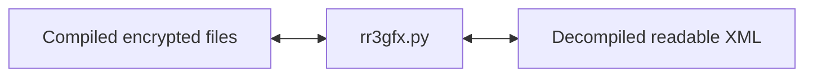
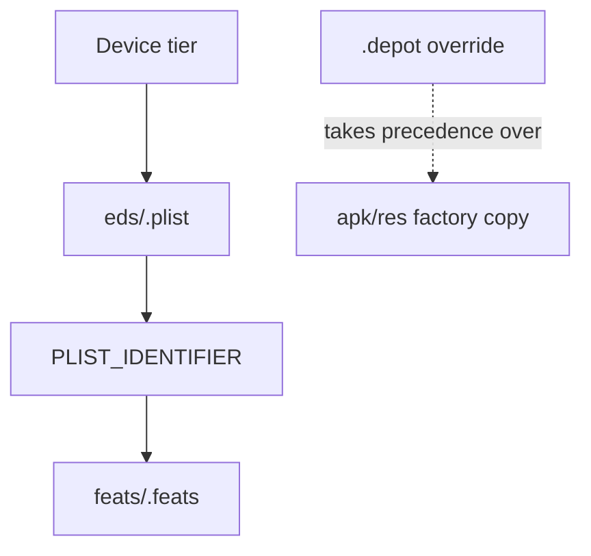

# RR3 Graphics Profiles

> **Preservation, inspection and modding tools for Real Racing 3 graphics profiles.**

[](https://www.python.org/)
[](LICENSE)
[](tools/rr3gfx.py)
[](docs/PRESETS.md)
[](https://github.com/Tankonline/RR3-Graphics-Profiles/actions/workflows/tests.yml)

An unofficial preservation project containing every graphics profile shipped with **Real Racing 3 14.0.1** and
`rr3gfx`, a dependency-free Python tool that decompiles and compiles the game's files byte for byte.

> [!IMPORTANT]
> **Disclaimer.** Real Racing 3 and the game data in `profiles/` are the property of Electronic Arts Inc. This is
> an unofficial fan project and is not affiliated with, endorsed by or supported by EA or Firemonkeys. The profile
> files are included for interoperability, preservation and modding research after the game's online services
> closed in March 2026. The game data is **not** covered by the MIT licence; only the tool and documentation are.
> Rights holders can request removal by opening an issue. Edit game files at your own risk and back up first.

## Why this exists

After Real Racing 3's online services closed in March 2026, preserving its device graphics profiles became more
important for interoperability, modding research and future tools. This repository keeps the original compiled files,
readable decompiled XML, the reverse-engineering record, and a tested fix for a black-screen bug on some newer GPUs.

## Contents

- [Fix my black screen](#fix-my-black-screen)
- [What's included](#whats-included)
- [Quick start](#quick-start)
- [Installing an edited profile](#installing-an-edited-profile-on-a-device)
- [How RR3 selects a profile](#how-rr3-selects-a-profile)
- [File format](#file-format)
- [Verifying the repository](#verifying-the-repository)
- [Documentation](#documentation)
- [Contributing](#contributing)

## Fix my black screen

If RR3 loads briefly and then the 3D scene goes black without a crash:

1. Back up the `.depot/eds/` and `.depot/feats/` folders on the device.
2. Apply the recommended **fix level B** to the preset your device uses:
   ```sh
   python3 tools/rr3gfx.py hdr profiles/compiled/eds/AndroidHigh.plist --level B -o AndroidHigh.plist
   ```
3. Copy the resulting **compiled** file to the matching `.depot/eds/` path.
4. Restart RR3. For evidence, device details and levels A/B/C, see [the HDR investigation](docs/HDR_BLACK_SCREEN.md).

The tested device was a Samsung SM-S948B with an Adreno 840 running Android 16. Other GPUs may not need this fix.

## What's included

| Path | Contents |
|---|---|
| `profiles/compiled/eds/` | 41 original encrypted render presets (`.plist`) |
| `profiles/compiled/feats/` | 42 original encrypted shader feature files (`.feats`) |
| `profiles/decompiled/` | Readable XML, the exact inverse of the compiled files |
| `tools/rr3gfx.py` | Single-file Python 3.8+ tool; standard library only |
| `tools/gen_docs.py` | Generator for the two generated documentation tables |
| `tools/tests/` | Unit tests covering profiles, safety and the CLI |
| `docs/` | Format, reverse-engineering, HDR, presets, settings and tool references |

### Tool features

| Command | Purpose |
|---|---|
| `decompile` | Convert compiled game files to readable XML |
| `compile` | Convert readable XML back to RR3-compatible compiled files |
| `info` | Inspect identifiers, screens, renderers, HDR switches and key counts |
| `diff` | Compare settings between two profiles |
| `verify` | Check byte-exact round trips |
| `hdr` | Apply HDR black-screen fix level A, B or C |
| `keystream` | Inspect or export the recovered 10,420-byte keystream |

### Data flow



## Quick start

You need Python 3.8 or newer. `rr3gfx` uses only the standard library.

### Windows

```powershell
py -3 tools/rr3gfx.py decompile profiles/compiled/eds/AndroidHigh.plist
py -3 tools/rr3gfx.py info profiles/compiled/eds/AndroidHigh.plist
py -3 tools/rr3gfx.py diff profiles/compiled/eds/AndroidHigh.plist profiles/compiled/eds/AndroidXtraHigh.plist
py -3 tools/rr3gfx.py hdr profiles/compiled/eds/AndroidHigh.plist --level B -o AndroidHigh.plist
```

### macOS/Linux

```sh
python3 tools/rr3gfx.py decompile profiles/compiled/eds/AndroidHigh.plist
python3 tools/rr3gfx.py info profiles/compiled/eds/AndroidHigh.plist
python3 tools/rr3gfx.py diff profiles/compiled/eds/AndroidHigh.plist profiles/compiled/eds/AndroidXtraHigh.plist
python3 tools/rr3gfx.py hdr profiles/compiled/eds/AndroidHigh.plist --level B -o AndroidHigh.plist
```

A ready-made readable copy is available at `profiles/decompiled/eds/AndroidHigh.plist`. Edit a copy, then compile it
before installing it. `.plist` files use CRLF and `.feats` files use LF; use `compile --eol` when needed. Files cannot
exceed the 10,420-byte recovered keystream.

## Installing an edited profile on a device

> [!WARNING]
> Close RR3 and back up `.depot/eds/` and `.depot/feats/` before changing anything. Editing game files is at your
> own risk. Install **compiled** files only; decompiled XML is not what RR3 expects.

For the Android ROW build:

```text
/storage/emulated/0/Android/data/com.ea.games.r3_row/files/apk/res/eds/    factory presets (leave alone)
/storage/emulated/0/Android/data/com.ea.games.r3_row/files/apk/res/feats/  factory features (leave alone)
/storage/emulated/0/Android/data/com.ea.games.r3_row/files/.depot/eds/     overrides RR3 actually loads
/storage/emulated/0/Android/data/com.ea.games.r3_row/files/.depot/feats/
```

1. Force-stop RR3.
2. Back up the `.depot/eds` and `.depot/feats` folders.
3. Copy the compiled file to the matching `.depot/eds/` path, for example:
   ```sh
   adb push AndroidHigh.plist /storage/emulated/0/Android/data/com.ea.games.r3_row/files/.depot/eds/AndroidHigh.plist
   ```
4. Start RR3 and restore the backup to undo the change.

On Android 11+, normal file managers may not reach `Android/data`; adb, Shizuku or root may be required. Replace the
package name for other RR3 builds.

## How RR3 selects a profile

RR3 chooses a preset name for the device, loads `eds/<name>.plist`, and then loads the feature file named after that
plist's `PLIST_IDENTIFIER`. Files in the writable `.depot` directory override factory copies in `apk/res`.



Android names include `AndroidLow`, `AndroidMid`, `AndroidMid2`, `AndroidHigh`, `AndroidXtraHigh` and
`AndroidUltraWide`; `SimRigTV` also exists. See [all presets](docs/PRESETS.md) for the complete table.

## File format

Both file types are plain-text XML XORed from byte 0 with one fixed 10,420-byte keystream. XOR encrypts and decrypts
with the same operation. There is no compression, header, checksum or signature.

- `.plist` files contain 113 render-setting keys and use CRLF line endings.
- `.feats` files contain 190 true/false shader-feature keys and use LF line endings.
- The keystream SHA-256 is `b8700d285217c1631d824c9521f3bf392d7f0d9bde79dd4ecb435af4347329c1`.

Read the exact details in [FORMAT.md](docs/FORMAT.md) and the recovery process in
[REVERSE_ENGINEERING.md](docs/REVERSE_ENGINEERING.md).

## Verifying the repository

```sh
python3 tools/rr3gfx.py verify profiles                 # verify: 166 ok, 0 failed
python3 -m unittest discover -s tools/tests -v
python3 tools/gen_docs.py && git diff --exit-code docs
```

On Windows, use `py -3` instead of `python3`. `.gitattributes` protects the profile line endings; if verification
fails after cloning, check `git config core.autocrlf` and re-clone.

## Documentation

- [FORMAT.md](docs/FORMAT.md): exact compiled/decompiled file format
- [REVERSE_ENGINEERING.md](docs/REVERSE_ENGINEERING.md): keystream recovery
- [HDR_BLACK_SCREEN.md](docs/HDR_BLACK_SCREEN.md): evidence and fix levels A/B/C
- [PRESETS.md](docs/PRESETS.md): generated table of all 41 presets
- [SETTINGS_REFERENCE.md](docs/SETTINGS_REFERENCE.md): generated key/value reference
- [TOOL.md](docs/TOOL.md): complete `rr3gfx` command reference
- [CONTRIBUTING.md](CONTRIBUTING.md): contribution rules
- [CHANGELOG.md](CHANGELOG.md): release history

## Contributing

Please read [CONTRIBUTING.md](CONTRIBUTING.md). In particular, never modify `profiles/`, edit generated docs by
hand, add untested setting meanings, or weaken `.gitattributes`.
